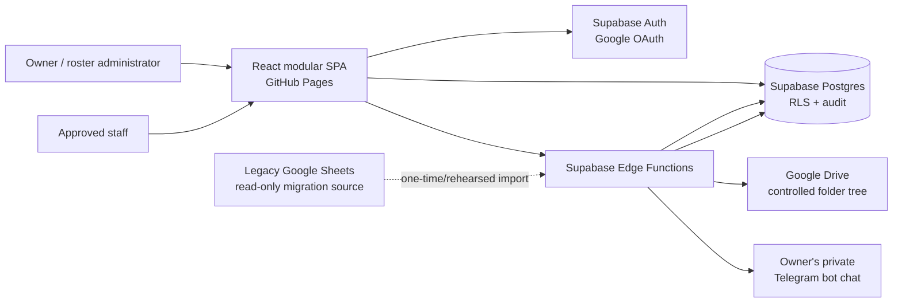

# Target Architecture

## Architectural style

Use a modular monolith: one deployable React SPA and one Supabase project, divided into explicit feature modules and database domains. This gives the maintenance benefits of modularity without the operational burden of microservices.

The browser is untrusted. It may render optimistic draft state, but authoritative writes, permissions, lifecycle transitions, document uploads and delivery are enforced server-side.

## System context



## Container responsibilities

### React SPA

- Routes, responsive layout and accessible interaction.
- Google sign-in initiation and session-aware navigation.
- Direct RLS-protected reads and ordinary self-service writes through `supabase-js`.
- Typed forms and client-side validation for fast feedback.
- Query caching and explicit invalidation.
- Local-only display preferences.
- Optimistic state only for safe, reversible draft operations.

The SPA never contains privileged credentials and never calls Google Drive or Telegram directly.

### Supabase Auth

- Google OAuth identity.
- Persistent refreshable sessions.
- Verified email claim.
- Account/session lifecycle.

The approved-email table and application roles remain the application authorization source; Google authentication alone does not grant data access.

### Supabase Postgres

- Canonical staff, request, roster, rule, professional-record and document metadata.
- Historical imported evidence and mappings.
- RLS enforcement.
- Atomic lifecycle, amendment and ledger operations.
- Idempotency, revisions and append-only audit.
- Views/RPCs for stable application contracts.

### Supabase Edge Functions

Use only where browser access is inappropriate or orchestration spans systems:

- account bootstrap/allowlist binding if implemented outside a database hook;
- Drive folder/file operations;
- PDF generation and archival;
- Telegram document delivery;
- migration extraction/import orchestration;
- privileged export and reconciliation jobs.

Edge Functions authenticate the caller, enforce owner role, validate input, create a short database transaction, perform external calls outside locks, and record the result.

### Google Drive

- Actual course certificates, practicing certificates, policies, templates and archived roster PDFs.
- Human-friendly folder navigation.
- Organization-controlled retention and sharing.

Drive is not queried as the application's database. Supabase stores stable file IDs and searchable metadata.

### Telegram

- Personal transfer inbox for the owner only.
- Receives an already archived PDF through a manual action.
- No staff bot, commands, subscriptions or broadcast behavior.

### Legacy Sheets

- Read-only migration source and independent audit evidence.
- No application dual-write after cutover.
- No requirement for a staging spreadsheet. Migration rehearsal uses exports and isolated Supabase environments.

## Frontend module map

```text
src/
  app/                    composition, router, providers, error boundaries
  platform/
    supabase/             client and generated database types
    auth/                 session bootstrap and route guards
    query/                query client and keys
    telemetry/            privacy-safe diagnostics
  shared/
    ui/                   design-system primitives
    forms/                common form adapters
    dates/                timezone and roster-date helpers
    validation/           shared schemas
    types/                cross-feature contracts only
  features/
    dashboard/
    directory/
    profiles/
    professional-records/
    requests/
    rosters/
      domain/             pure roster calculations
      data/               queries, commands, DTO mapping
      components/
      routes/
    rules/
    documents/
    settings/
    audit/
  routes/                 route registration only
```

Feature internals are private by default. A feature exports a small public API from its root `index.ts`.

## Data-flow patterns

### Ordinary read

```text
route loader/component → typed query hook → Supabase view/table under RLS
                       → normalized DTO → presentational component
```

### Safe self-service write

```text
form → Zod validation → RLS-protected insert/update → invalidate exact query keys
```

### Critical roster command

```text
UI command
  → authenticated RPC/Edge Function with operation_id + expected_revision
  → short database transaction validates role and revision
  → writes linked records atomically
  → returns new revision and audit ID
  → client replaces optimistic/pending state with confirmed state
```

### External document workflow

```text
database snapshot transaction
  → commit
  → PDF render
  → Drive upload
  → database delivery-state update
  → optional separate Telegram send
```

No database lock is held during a Drive or Telegram network request.

## State ownership

- Server state: TanStack Query (or equivalent) backed by Supabase.
- Form state: React Hook Form plus Zod schemas.
- Roster editor draft: feature-local reducer/state machine with server revision and pending-operation map.
- Display preferences: localStorage using namespaced, versioned keys.
- Authentication: Supabase session, not a custom username or PIN.
- Cross-page global state: keep minimal; do not create a second client database.

## Concurrency and idempotency

- Every command has a UUID `operation_id` unique per logical user action.
- The database stores the original command result; retries return it rather than repeating effects.
- Mutable aggregates carry a monotonically increasing `revision`.
- Commands include `expected_revision`; mismatch returns a conflict payload.
- Linked person/date rows are locked in stable ID/date order.
- Draft edits may debounce and coalesce before submission.
- Publish, amend, close, reopen, ledger and snapshot operations never use silent last-write-wins.

## Realtime boundary

Realtime is optional and should initially invalidate affected query keys rather than stream arbitrary row mutations into editor state. A roster editor that has unsaved local operations must display a conflict banner instead of merging remote changes automatically.

## Error model

All data/command errors use a stable envelope:

```ts
type AppError = {
  code: string;
  message: string;
  correlationId?: string;
  fieldErrors?: Record<string, string>;
  retryable: boolean;
  currentRevision?: number;
};
```

User messages state what happened and how to recover. Logs may include technical detail but never tokens, document contents or unnecessary personal data.

## Architecture quality attributes

- Security: database-enforced access and secret isolation.
- Auditability: immutable snapshots/events and traceable external delivery.
- Maintainability: feature isolation and typed contracts.
- Reliability: idempotent commands, revisions and retriable external calls.
- Performance: narrow queries, indexed foreign keys and no full-dataset refreshes.
- Accessibility: WCAG 2.2 AA target.
- Portability: static frontend may move away from GitHub Pages without rewriting feature modules.

