# Google Sheets Migration and Cutover

## Migration principle

The live Google Sheets workbook may be used as the read-only migration source. A separate staging Google Sheet is not required. All experimentation occurs against exported files and isolated Supabase environments.

“Migrate as-is” means preserving an immutable raw representation of every source tab/row before transforming it into the normalized application model. It does not mean reproducing Sheets column design as the production database schema.

## Safety rules

- No migration script writes to the live workbook.
- Capture spreadsheet ID, tab names, header rows, export time, source revision where available and hashes.
- Take a human-accessible workbook backup before final export.
- Treat formulas separately from displayed values; inventory both where relevant.
- Never infer missing planned roster history or GOFF from overwritten cells.
- Historical periods remain read-only after import.
- Every transformed canonical row links to its batch and source row/key.
- Re-running a batch is idempotent and cannot silently duplicate data.

## Migration pipeline

```mermaid
flowchart LR
    Inventory[Inventory workbook/tabs]
    Export[Read-only export\nraw CSV/JSON + hashes]
    Raw[Load legacy.raw_rows]
    Validate[Validate headers/types/duplicates]
    Transform[Transform to canonical tables]
    Reconcile[Counts, checksums, business totals]
    Review[Owner exception review]
    Freeze[Freeze final source window]
    Delta[Final delta export/import]
    Cutover[Enable Supabase-only app]

    Inventory --> Export --> Raw --> Validate --> Transform --> Reconcile --> Review --> Freeze --> Delta --> Cutover
```

## Phase 1 — source inventory

For every workbook/tab record:

- spreadsheet and tab ID/name;
- purpose and owner;
- header row and data range;
- row count and unique key candidate;
- formulas, protections and dependent scripts;
- date/time and blank-value conventions;
- staff identity fields;
- known duplicate or malformed values;
- whether it is operational, reference, derived or obsolete;
- canonical target table or raw-only retention.

Expected domains include requests, MasterRoster/roster lifecycle data, amendments, staff/team directories, emergency physicians/specialists, shift types/blocks, limit groups, settings, activities/updates, public holidays, leave applications and newer V2 lifecycle/ledger tables.

## Phase 2 — immutable export

- Use a least-privilege read-only export mechanism.
- Export raw cell values and, where needed, formula text/display values.
- Save a manifest and SHA-256 per export artifact.
- Assign one `import_batch_id`.
- Store source artifacts in a controlled migration folder, not the public repository.
- Load rows into `legacy.raw_rows` in batches.

No AI prompt or test fixture should contain unnecessary real personal data. Use masked/synthetic subsets for development.

## Phase 3 — identity reconciliation

Staff identity is the highest-risk transform.

1. Normalize whitespace/case but preserve raw values.
2. Build candidate mapping using staff code, verified email and reviewed roster name.
3. Flag collisions, renames, duplicate emails and inactive staff.
4. Owner approves ambiguous mappings.
5. Assign stable `staff_directory.id` values.
6. Store all source-to-canonical mappings.

Never merge two people based only on a similar name.

## Phase 4 — domain transforms

### Historical rosters

- Import person/date/shift values and source context.
- Mark periods `legacy_read_only=true`.
- If no trustworthy planned snapshot exists, planned equals current and the UI labels the period Legacy.
- Preserve raw PN and unknown shift codes.
- Do not apply January 2027 rules retroactively.

### Requests and leave

- Preserve original status, submitted/decision dates, references and source IDs.
- Map known statuses explicitly; unknown status remains preserved and flagged.
- Keep operational categories but exclude unnecessary medical detail from new normalized fields.

### Settings and rules

- Import raw settings for evidence.
- Create reviewed typed rule-version drafts rather than activating raw free text automatically.
- Owner validates effective dates, thresholds and shift mappings.

### Professional records/documents

- Initially import metadata known from Sheets.
- Link Drive files in a separate reconciliation pass using stable file IDs.
- Do not move/rename existing Drive files automatically during first import.

## Phase 5 — reconciliation

Every batch produces:

- source/export/raw/canonical row counts;
- duplicate-key counts;
- rejected/unknown value counts;
- staff mapping coverage;
- request counts by status/month/person;
- roster counts/checksums by period/person/date/shift;
- leave/holiday counts;
- settings/rule mapping report;
- document link counts and missing files;
- exception list with owner disposition.

Required result is not necessarily zero exceptions; it is zero unexplained exceptions.

## Rehearsals

Run at least two full rehearsals:

### Rehearsal A

- Discover source shape and transformation errors.
- Use non-production Supabase.
- Produce first reconciliation report.

### Rehearsal B

- Run the documented process from a clean environment.
- Time the full export/import/reconciliation.
- Confirm idempotent rerun behavior.
- Perform UAT using a masked or approved dataset.

Final production import must use the same versioned scripts and mapping decisions.

## Cutover strategy

1. Keep legacy app live while replacement is built.
2. Set a final legacy write window/freeze agreed with the owner.
3. Export final full or delta source data.
4. Import and reconcile production Supabase.
5. Confirm January 2027 staff list, rules, opening balances and roster period.
6. Run smoke/security tests.
7. Switch the public application URL to the replacement.
8. Put legacy app/workbook into clearly labeled read-only mode.
9. Monitor and reconcile first real operations.

Do not dual-write Sheets and Supabase during normal production. If cutover fails, roll back the application URL and explicitly declare Supabase writes paused; do not attempt unsupervised two-way merge.

## Rollback

Rollback triggers include authorization failure, missing/corrupt roster data, unacceptable reconciliation mismatch, inability to publish/amend safely, or production-wide instability.

Rollback steps:

1. Disable replacement write feature flag.
2. Preserve Supabase operation/audit evidence.
3. Repoint the public URL to the legacy application.
4. Announce which system is authoritative.
5. Export post-cutover Supabase operations for reviewed recovery.
6. Fix and repeat reconciliation before another attempt.

Never erase failed-cutover records to make counts match.

## Migration acceptance gates

- 100% source tabs classified.
- 100% active staff mapped or intentionally excluded with reason.
- Historical roster person/date/shift checksums reconcile for sampled and aggregate periods.
- Every rejected row has documented disposition.
- January 2027 configuration and roster are created natively, not imported as legacy.
- Production import is reproducible from the manifest and versioned code.
- Legacy source backup is verified readable.

